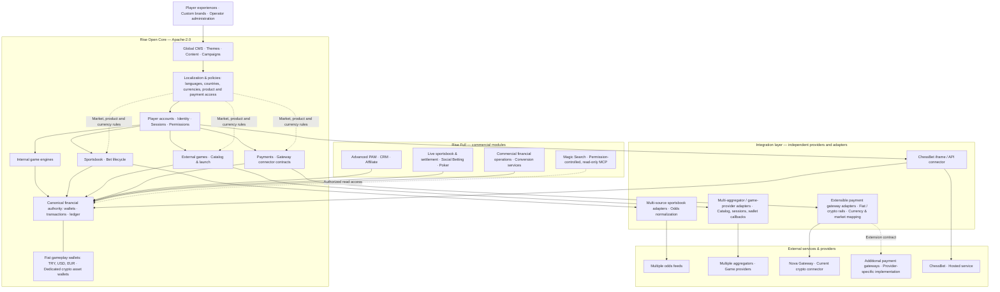

# Rise Open Core

**Open-Source Social Crypto Casino & Sportsbook. Build your own games, products, and experiences.**

Rise Open Core brings casino games, sportsbook infrastructure, player accounts, payments, wallets, and operational tools together on one platform. With a global CMS and flexible theming, you can build your brand, connect new games, enter different markets, and shape the software around your ideas.

Released under the **Apache License 2.0**, Rise Open Core is free to download, fork, modify, and use commercially.

[Rise iGaming](https://riseigaming.com/) · [WinX](https://winx.now/) · [License](LICENSE) · [Developer Guide](docs/START_HERE.md)

## What Can You Do with Rise?

Building a casino, sportsbook, or gaming product shouldn't mean rebuilding player accounts, sessions, wallets, administration panels, and transaction systems from scratch.

Rise gives you that foundation so you can focus on what makes your product different.

A game studio can integrate its own engine. An agency can create a completely different brand experience. A fintech team can connect a new payment service. You can develop your own sportsbook or work with Rise's commercial solutions without leaving the same technology ecosystem.

**Using a platform is one thing. Having the freedom to shape its future is another.**

You shouldn't have to wait for a provider's roadmap every time you want to launch a new game, campaign, or business model. Build your own themes, games, and modules. Bring new B2B or B2C products into your platform, and design the commercial and commission models for the games you create.

## What's Included?

- **Global CMS & Themes:** Manage menus, sliders, pages, campaigns, and promotions. TR/EN/ES language infrastructure with flexible rules for countries, games, products, payment methods, and currencies, giving you control over the experience in each market.
- **8 Built-in Games:** Dice, European Roulette, Blackjack Classic, Blackjack Salon, SkyRush, Orbit X, Big Win, and Fusion Reels. Connect your own engines to the same session and wallet infrastructure.
- **Sportsbook:** Bet slips, bet acceptance, pending transactions, cancellations, and refunds, with data adapters and normalization for multiple odds feeds.
- **Game Provider Integrations:** Catalog management, game launches, sessions, and wallet callbacks for multiple aggregators and providers.
- **Payments:** Nova Gateway crypto payment integration and contracts for connecting additional payment providers.
- **Operations Overview:** Explore player, game, provider, and financial activity through permission-controlled, read-only records, transaction histories, and operational events.
- **Agent-Ready Development:** Extend the software with AI coding agents working from the source code, technical contracts, tests, and developer guides.

### Unified Fiat & Crypto Wallet Infrastructure

Fiat and crypto assets share a unified player account, transaction, and ledger architecture. TRY, USD, and EUR gameplay wallets work alongside dedicated crypto asset wallets, keeping balances and financial records organized within the same system.

Exchange rates, fees, transfers, and conversion models provide the foundation for building crypto-to-fiat financial flows. Rise Full expands this architecture with commercial conversion services and more advanced financial operations.

## Architecture



Conceptual architecture and product boundaries. Rise Open Core includes the adapter contracts and Nova connector; additional payment protocols require their own implementations and acceptance. Provider availability, payment rails, currencies and products depend on integration and market policies. Rise Full modules and external hosted engines are outside the Open Core source distribution.

## Who Is Rise For?

**Developers & Game Studios:** Build your own casino games, sportsbooks, and new gaming experiences without starting from an empty codebase.

**Startups & Technology Teams:** Create products around social gaming, AI, crypto payments, fintech, and digital economies.

**Agencies & Integration Partners:** Develop custom themes, games, modules, and provider integrations for different clients and brands.

**iGaming Operators:** Take greater control of your technology, incorporate your own developments, and expand into new markets.

**Research & Education Teams:** Explore gaming economies, security, AI interactions, and financial workflows in controlled environments.

## What Can You Build?

Create your own casino or sportsbook. Develop original game engines, social gaming communities, AI-powered operational tools, custom campaign systems, multi-brand platforms, and payment integrations. Build adapters for gaming and payment providers, experiment with new products, and test them with synthetic data.

Rise gives you the foundation. What you build on top is up to you.

[Explore all use cases](docs/USE_CASES.md).

## Open Core vs Rise Full

Two ways to build on the same technology: **Rise Open Core** gives you the open-source foundation to develop and run on your own infrastructure. **Rise Full** adds live operations, advanced business tools, and Rise-hosted commercial delivery options.

| **Feature** | **Rise Open Core** | **Rise Full** |
|:---|:---|:---|
| **Game Catalog** | **8 built-in games** | **18,000+ games** (including provider catalog) |
| Game Providers | Multi-provider adapters | **160+ game providers** and commercial game catalog |
| Global CMS & Themes | Included | Included |
| Your Own Games & Modules | Develop and integrate | Develop and deploy |
| Sportsbook | Bet slips, acceptance, pending, cancellations | Live markets & Settlement Engine |
| Fiat & Crypto Wallets | Wallet, ledger & conversion models | Advanced finance & conversion |
| Affiliate | Integration-ready foundation | Affiliate Engine |
| CRM & Operations | CMS & Operations Overview | Advanced CRM, reporting & Magic Search |
| Player Account Management (PAM) | Player accounts & canonical wallets | Advanced PAM |
| Social Betting & Poker Engine | Not included | Commercial modules |
| **AI-Native Operations · MCP** | Not included | MCP-ready, permission-controlled read-only access |
| Nova Gateway | Access to Rise payment services | Rise payment services |
| ChessBet | iframe/API connector | Hosted ChessBet service |
| Hosting | Self-hosted | Rise-hosted White-label or Turnkey |

The **18,000+ games** are part of the Rise Full commercial provider catalog. Rise Open Core includes eight built-in games in its source distribution.

### What Does Rise Full Add?

**Live Sportsbook & Settlement Engine**

Live markets, bet settlement, odds feed integrations, and risk and limit management. Develop your sportsbook with your own team or choose Rise's integrated sportsbook service.

**Affiliate Engine**

Manage affiliate partnerships, referrals, commission structures, player acquisition, and performance.

**Advanced CRM & Business Operations**

Bring together player segmentation, campaigns, bonuses, loyalty and VIP programs, financial analytics, and reporting.

**Magic Search** — Explore operational records, player journeys, and behavioral patterns through natural-language queries within authorized data boundaries.

**Social Betting & Poker Engine** — Social betting experiences and a Texas Hold’em poker engine, including tournament capabilities where provided by the commercial package.

**Player Account Management (PAM)** — Advanced player account management built on the shared account, session, wallet, and access-control architecture.

**Game Content & Customization**

Access **18,000+ games from an ecosystem of 160+ game providers**, while adding your own games, themes, campaigns, and product modules.

**AI-Native Operations · MCP Ready**

Use ChatGPT, Claude, Gemini, OpenCode, and other MCP-compatible AI clients to investigate player accounts, canonical wallets, gaming activity, risk limits, and operational events in natural language.

Access is **permission-controlled, evidence-based, and read-only**. AI helps teams understand what's happening across the platform. Financial transactions, game outcomes, and access permissions remain governed by server-side rules.

**Nova Gateway**

Our multi-asset crypto payment service is available to both Open Core and Rise Full customers. Rise operates the gateway; Open Core provides the integration layer.

**ChessBet**

Our hosted chess betting service for Rise Full customers, connecting to the existing player and financial experience through iframe/API integrations.

### White-label

**Launch under your own brand.**

Use Rise's hosted and managed platform while making the experience your own. Choose your themes, game selection, content, campaigns, and operational settings. Add the games and modules your team develops as your product grows.

Rise handles hosting and the platform infrastructure. You decide how your brand evolves.

### Turnkey

**Run your iGaming business on an integrated platform.**

Bring casino, sportsbook, game providers, payments, finance, CRM, and affiliate tools together in a complete commercial solution hosted and managed by Rise.

Instead of assembling separate systems from multiple vendors, start with a connected platform and keep extending it with your own games, modules, and products.

**Both models preserve your freedom to build.** Choosing a hosted platform shouldn't limit you to the options already available in its administration panel.

### Build vs Buy

Closed-source iGaming platforms often come with substantial setup fees, ongoing costs, and revenue-sharing agreements. Paying those fees doesn't automatically give you the right to modify the underlying software or independently introduce new features.

Rise brings open-source development freedom into hosted commercial iGaming.

Explore 2026 pricing references, revenue-sharing models, and software ownership in [**Build vs Buy: Cost & Ownership**](docs/PRODUCT_PORTFOLIO.md#build-vs-buy).

## Built with Rise

### WinX — Production Reference

WinX is an iGaming platform built and operated with Rise technology. It shows how player accounts, gaming experiences, sportsbook, and operational infrastructure come together in a real-world implementation.

[Explore WinX](https://winx.now/)

## Licensing & Going Live

Apache License 2.0 allows you to use, modify, and commercially distribute the software. Operating a real-money casino or sportsbook also requires the appropriate licenses for your target markets.

**Already licensed?** Connect your own game aggregators, providers, and licensed odds feed sources through Rise's integration architecture. Build your own sportsbook experience or choose the live sportsbook services available with Rise Full.

**Not licensed yet?** Rise iGaming can help you explore licensing options, define your market and operational requirements, and prepare a path toward a White-label or Turnkey solution.

[Explore Rise iGaming](https://riseigaming.com/)

## Quick Start

**Technology & local development requirements:** Laravel 12.71, PHP 8.4.1+ (with required extensions), Composer 2, native MariaDB, Python 3.8+, macOS or Linux. No Node.js build required.

**Estimated local machine sizing:** 2 CPU cores and 4 GB RAM as a starting point; 4 cores and 8 GB RAM recommended for more comfortable development. These are planning estimates, not measured minimums or production capacity guidance. See the [installation runbook](docs/INSTALL_RUN34.md) for exact prerequisites.

Clone Rise Open Core and prepare a clean local development environment:

```bash
git clone https://github.com/riseigaming/rise-open-core.git
cd rise-open-core
git rev-parse HEAD

mkdir ../rise-local
git archive HEAD | tar -xf - -C ../rise-local
cd ../rise-local

python3 scripts/verify-source-manifest.py SOURCE_SHA256.json
./rise web-setup --port 18734
```

The installation guide walks you through an isolated MariaDB environment, configuration, and initial administrator setup.

[Developer Getting Started](docs/START_HERE.md) · [Installation Guide](docs/INSTALL_WIZARD.md) · [Detailed Installation](docs/INSTALL_RUN34.md)

## Documentation & License

**Developer Resources**

[Getting Started](docs/START_HERE.md) · [Feature Map](docs/CAPABILITY_MAP.md) · [API & Integration Examples](docs/developer/INTEGRATION_EXAMPLES.md) · [AI-Assisted Development](docs/AI_AGENT_ONBOARDING.md) · [Updating](UPDATING.md) · [Changelog](CHANGELOG.md) · [Contributing](CONTRIBUTING.md) · [GitBook Documentation](https://rise-14.gitbook.io/rise-docs/)

**License & Security**

[Apache-2.0 License](LICENSE) · [Distribution](DISTRIBUTION.md) · [Copyright Notices](NOTICE) · [Third-Party Licenses](docs/THIRD_PARTY_NOTICES.md) · [Security Policy](SECURITY.md)

Third-party components retain their respective license terms.
